### About

Software engineer focused on frontend, with a product mindset. I build thoughtful digital experiences with React, Next.js and TypeScript, and enjoy turning technical ideas into real products.

<picture>
  <source media="(prefers-color-scheme: dark)" srcset="https://raw.githubusercontent.com/KarlaTovar-06/KarlaTovar-06/output/terminal-dark.gif">
  <source media="(prefers-color-scheme: light)" srcset="https://raw.githubusercontent.com/KarlaTovar-06/KarlaTovar-06/output/terminal.gif">
  
</picture>

### Stack

  <picture><source media="(prefers-color-scheme: dark)" srcset="https://iconic-api.onrender.com/dark/react"></picture>
  <picture><source media="(prefers-color-scheme: dark)" srcset="https://iconic-api.onrender.com/dark/nextjs"></picture>
  <picture><source media="(prefers-color-scheme: dark)" srcset="https://iconic-api.onrender.com/dark/typescript"></picture>
  <picture><source media="(prefers-color-scheme: dark)" srcset="https://iconic-api.onrender.com/dark/js"></picture>
  <picture><source media="(prefers-color-scheme: dark)" srcset="https://iconic-api.onrender.com/dark/html"></picture>
  <picture><source media="(prefers-color-scheme: dark)" srcset="https://iconic-api.onrender.com/dark/css"></picture>
  <picture><source media="(prefers-color-scheme: dark)" srcset="https://iconic-api.onrender.com/dark/tailwind"></picture>
  <picture><source media="(prefers-color-scheme: dark)" srcset="https://iconic-api.onrender.com/dark/python"></picture>
  <picture><source media="(prefers-color-scheme: dark)" srcset="https://iconic-api.onrender.com/dark/php"></picture>
  <picture><source media="(prefers-color-scheme: dark)" srcset="https://iconic-api.onrender.com/dark/laravel"></picture>
  <picture><source media="(prefers-color-scheme: dark)" srcset="https://iconic-api.onrender.com/dark/swift"></picture>
  <picture><source media="(prefers-color-scheme: dark)" srcset="https://iconic-api.onrender.com/dark/unity"></picture>
  <picture><source media="(prefers-color-scheme: dark)" srcset="https://iconic-api.onrender.com/dark/git"></picture>
  <picture><source media="(prefers-color-scheme: dark)" srcset="https://iconic-api.onrender.com/dark/figma"></picture>

### GitHub

  <picture>
    <source media="(prefers-color-scheme: dark)" srcset="https://github-readme-stats.vercel.app/api?username=KarlaTovar-06&show_icons=true&hide_border=true&rank_icon=github&theme=transparent&title_color=E56CC4&icon_color=00C2AB&text_color=C9D1D9">
    <source media="(prefers-color-scheme: light)" srcset="https://github-readme-stats.vercel.app/api?username=KarlaTovar-06&show_icons=true&hide_border=true&rank_icon=github&theme=transparent&title_color=A22887&icon_color=00C2AB&text_color=374151">
    
  </picture>
  <picture>
    <source media="(prefers-color-scheme: dark)" srcset="https://github-readme-stats.vercel.app/api/top-langs/?username=KarlaTovar-06&layout=compact&hide_border=true&theme=transparent&title_color=E56CC4&text_color=C9D1D9">
    <source media="(prefers-color-scheme: light)" srcset="https://github-readme-stats.vercel.app/api/top-langs/?username=KarlaTovar-06&layout=compact&hide_border=true&theme=transparent&title_color=A22887&text_color=374151">
    
  </picture>

  <picture>
    <source media="(prefers-color-scheme: dark)" srcset="https://streak-stats.demolab.com?user=KarlaTovar-06&hide_border=true&theme=transparent&ring=E56CC4&fire=D73961&currStreakNum=F0F6FC&sideNums=F0F6FC&currStreakLabel=E56CC4&sideLabels=8B949E&dates=8B949E&stroke=30363D">
    <source media="(prefers-color-scheme: light)" srcset="https://streak-stats.demolab.com?user=KarlaTovar-06&hide_border=true&theme=transparent&ring=A22887&fire=D73961&currStreakNum=111827&sideNums=111827&currStreakLabel=A22887&sideLabels=6B7280&dates=6B7280&stroke=E5E7EB">
    
  </picture>

### Activity

  <picture>
    <source media="(prefers-color-scheme: dark)" srcset="https://raw.githubusercontent.com/KarlaTovar-06/KarlaTovar-06/output/snake-dark.svg">
    <source media="(prefers-color-scheme: light)" srcset="https://raw.githubusercontent.com/KarlaTovar-06/KarlaTovar-06/output/snake.svg">
    
  </picture>

