### About

Software engineer focused on frontend, with a product mindset. I build thoughtful digital experiences with React, Next.js and TypeScript, and enjoy turning technical ideas into real products.

### Stack

### GitHub

  
  

  

### Activity

