  

  <picture><source media="(prefers-color-scheme: dark)" srcset="https://iconic-api.onrender.com/dark/react"></picture>
  <picture><source media="(prefers-color-scheme: dark)" srcset="https://iconic-api.onrender.com/dark/nextjs"></picture>
  <picture><source media="(prefers-color-scheme: dark)" srcset="https://iconic-api.onrender.com/dark/typescript"></picture>
  <picture><source media="(prefers-color-scheme: dark)" srcset="https://iconic-api.onrender.com/dark/js"></picture>
  <picture><source media="(prefers-color-scheme: dark)" srcset="https://iconic-api.onrender.com/dark/html"></picture>
  <picture><source media="(prefers-color-scheme: dark)" srcset="https://iconic-api.onrender.com/dark/css"></picture>
  <picture><source media="(prefers-color-scheme: dark)" srcset="https://iconic-api.onrender.com/dark/tailwind"></picture>
  <picture><source media="(prefers-color-scheme: dark)" srcset="https://iconic-api.onrender.com/dark/python"></picture>
  <picture><source media="(prefers-color-scheme: dark)" srcset="https://iconic-api.onrender.com/dark/php"></picture>
  <picture><source media="(prefers-color-scheme: dark)" srcset="https://iconic-api.onrender.com/dark/laravel"></picture>
  <picture><source media="(prefers-color-scheme: dark)" srcset="https://iconic-api.onrender.com/dark/swift"></picture>
  <picture><source media="(prefers-color-scheme: dark)" srcset="https://iconic-api.onrender.com/dark/unity"></picture>
  <picture><source media="(prefers-color-scheme: dark)" srcset="https://iconic-api.onrender.com/dark/git"></picture>
  <picture><source media="(prefers-color-scheme: dark)" srcset="https://iconic-api.onrender.com/dark/figma"></picture>

  <picture>
    <source media="(prefers-color-scheme: dark)" srcset="https://raw.githubusercontent.com/KarlaTovar-06/KarlaTovar-06/output/snake-dark.svg" />
    <source media="(prefers-color-scheme: light)" srcset="https://raw.githubusercontent.com/KarlaTovar-06/KarlaTovar-06/output/snake.svg" />
    
  </picture>

